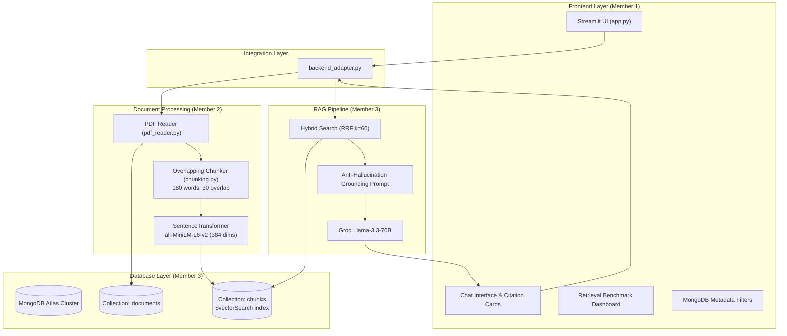

# DevDocs AI – Developer Documentation Assistant
> **Track 2: RAG Engine** — *Build a product that turns your own source material into grounded, useful results.*

[](https://www.python.org/)
[](https://www.mongodb.com/atlas/database)
[](https://groq.com/)
[-purple.svg)](https://huggingface.co/sentence-transformers/all-MiniLM-L6-v2)
[](https://streamlit.io/)
[](tests/)

---

## ⚡ Project Overview

**DevDocs AI** is a production-grade Retrieval-Augmented Generation (RAG) system engineered for engineering teams, technical architects, and developers. It transforms disparate technical PDF documentation, API specifications, and architectural runbooks into grounded, verifiable answers with exact source citations.

Built specifically to conquer **Track 2: RAG Engine**, DevDocs AI excels at:
- **Multi-Document Synthesis**: Combining evidence across distant sections and differing document revisions.
- **Automated Conflict Detection**: Detecting and explaining contradictory specifications across API versions instead of hallucinating.
- **Strict Anti-Hallucination & Refusal**: Refusing out-of-context or unanswerable queries with zero fabrication.
- **MongoDB Atlas Hybrid Search**: Fusing dense semantic vector search with sparse keyword search using **Reciprocal Rank Fusion (RRF)**.
- **Live Retrieval Evaluation**: Continuous evaluation measuring **Hit Rate@K**, **Precision@K**, and **Recall@K**.

---

## 🏗️ System Architecture



---

## 🚀 Key Features

### 1. Ingestion & Duplicate Prevention
- **SHA-256 Content Hashing**: Prevents re-indexing identical PDFs regardless of renaming.
- **Isolated Path Preservation**: Safe multi-file concurrent storage in `data/<hash[:8]>/<filename>`.
- **Word-Level Overlap**: Preserves sentence boundaries and heading context across chunk edges.

### 2. MongoDB Atlas Vector Search & Hybrid RRF
- **Vector Search**: Computes 384-dimensional cosine similarity via MongoDB Atlas `$vectorSearch`.
- **Keyword Search**: Regex/lexical term matching for technical code symbols, endpoints, and error codes.
- **Reciprocal Rank Fusion (RRF)**: Principled score blending ($k=60$) prioritizing consensus chunks across dense and sparse retrievers.

### 3. Metadata Filtering
- Filter searches across **all documents** or lock search context to a specific document/version using MongoDB metadata query filters (`{"document_name": "..."}`).

### 4. Grounded Citations & Conflict Resolution
- Every AI response features expandable **📌 Source Citations** quoting Document Name, Page Number, Section, and exact verbatim text.
- If conflicting versions exist (e.g. v1 port 8000 vs v2 port 8443), the model explicitly flags the contradiction and cites both sources.

### 5. Live Retrieval Evaluation (MongoDB Skill Badge)
- Built-in information retrieval benchmark measuring:
  - **Hit Rate@5**: Percentage of queries with ground-truth chunks in top-5.
  - **Precision@5**: Ratio of relevant chunks among retrieved candidates.
  - **Recall@5**: Coverage of all required evidence chunks.

---

## 📋 3-Minute Hackathon Demo Script for Judges

| Step | Action in UI | What to Say to Judges |
| :---: | :--- | :--- |
| **1** | Click **"📚 Add Curated Dataset"** in Sidebar | *"We load 3 real-world technical specs: FastAPI v1.2, Security v2.0, and MongoDB Cluster Spec. Chunks and 384-dim embeddings are stored directly in MongoDB Atlas."* |
| **2** | Click **"📑 Multi-Doc: Compare Auth v1 vs v2"** | *"Watch how DevDocs AI synthesizes evidence across both version 1 and version 2 documents, quoting exact pages in the expandable citation drawer."* |
| **3** | Click **"⚔️ Conflict: Service Port & Endpoint"** | *"Here is our conflict detection engine: v1 specifies port 8000 while v2 specifies port 8443. The model detects the breaking change and explicitly explains the contradiction instead of hallucinating."* |
| **4** | Click **"❓ Refusal: Unanswerable Request"** | *"If a user asks about pizza or unrelated topics, our evidence validation threshold triggers an immediate, grounded refusal: 'The answer is not available in the uploaded documents'."* |
| **5** | Click **"📊 Artefact: Generate API Comparison"** | *"The engine generates structured artifacts—here, a clean markdown migration table summarizing ports, auth methods, and token TTLs."* |
| **6** | Open Sidebar **"📊 Retrieval Benchmark"** & click **"⚡ Run"** | *"We prove our retrieval accuracy using Information Retrieval metrics—Hit Rate, Precision, and Recall—directly qualifying for the MongoDB Retrieval Evaluation Badge."* |

---

## 🛠️ Setup & Installation

### Prerequisites
- Python 3.12+
- MongoDB Atlas cluster with Vector Search enabled
- Groq API Key

### 1. Clone & Setup Virtual Environment
```bash
git clone https://github.com/YourRepo/Uncharted-RAG-Engine.git
cd Uncharted-RAG-Engine
python -m venv .venv
.\.venv\Scripts\activate
pip install -r requirements.txt
```

### 2. Configure Environment Variables
Create a `.env` file based on `.env.example`:
```env
MONGODB_URI=mongodb+srv://<username>:<password>@cluster0.mongodb.net/?retryWrites=true&w=majority
MONGODB_DATABASE=devdocs_ai
MONGODB_DOCUMENTS_COLLECTION=documents
MONGODB_CHUNKS_COLLECTION=chunks
MONGODB_VECTOR_INDEX_NAME=chunks_vector_index

GROQ_API_KEY=gsk_your_groq_api_key_here
LLM_MODEL=llama-3.3-70b-versatile
EMBEDDING_MODEL_NAME=sentence-transformers/all-MiniLM-L6-v2
```

### 3. Run Automated Tests
```bash
# Run complete test suite (32 tests across 8 suites)
.\.venv\Scripts\pytest.exe tests/ -v
.\.venv\Scripts\python.exe test_pdf.py
.\.venv\Scripts\python.exe test_chunking.py
.\.venv\Scripts\python.exe test_embeddings.py
.\.venv\Scripts\python.exe test_document_processor.py
```

### 4. Launch Application
```bash
.\.venv\Scripts\streamlit.exe run app.py
```
Open **[http://localhost:8501](http://localhost:8501)** in your browser.

---

## 👥 Team Responsibilities
- **Member 1**: Frontend Development, Streamlit UI/UX, Citation Expanders, Metadata Filtering Controls, Integration Adapter.
- **Member 2**: Document Ingestion Pipeline, PDF Extraction, Text Chunking, 384-dim Embedding Generation.
- **Member 3**: MongoDB Atlas Database Architecture, `$vectorSearch`, Hybrid RRF Retrieval, LLM Grounding, IR Benchmark Evaluation.
